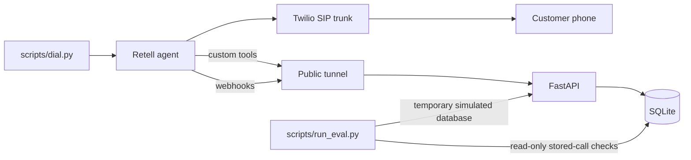

# Autopay Recovery Agent

An Agent Studio take-home for the Razorpay Forward-Deployed Engineer role — option 2, a voice agent for failed autopay recovery.

## Table of contents

- [Overview](#overview)
- [Architecture](#architecture)
- [Repository layout](#repository-layout)
- [Safety and policy design](#safety-and-policy-design)
- [Setup and run](#setup-and-run)
- [Evaluation](#evaluation)
- [Cost](#cost)
- [Assumptions and limitations](#assumptions-and-limitations)
- [Known issues and fixes](#known-issues-and-fixes)
- [Long-term fix and production path](#long-term-fix-and-production-path)
- [Live call demonstration](#live-call-demonstration)

## Overview

Recurring payments can fail for reasons such as insufficient funds, an expired card, or an expired mandate. This project supplies a narrow, safety-first recovery agent: it can explain the tool-backed failed-payment context after identity confirmation, offer a mock payment link after consent, capture a promised payment or a claimed payment, schedule a retry, honor an opt-out, or escalate to a person.

The seeded SQLite database contains 10 fictional customers and 10 fictional failed-payment records. The data exists solely to exercise policy and tool behavior; the mock payment link and mock SMS do not collect funds or renew an autopay mandate.

The latest offline harness report is [reports/eval_report.md](reports/eval_report.md). Its scripted funnel is explicitly **SIMULATED**, not a real-world recovery result. Its stored transcript checks and cost samples are labeled **MEASURED**; see the report’s sample sizes and limitations before drawing conclusions.

## Architecture



| Component | Responsibility |
|---|---|
| `scripts/dial.py` | Builds dynamic variables, applies dial rules, previews calls, and requires an explicit live-call confirmation. |
| Retell | Hosts the LLM and voice agent, invokes custom tools, and emits call webhooks. |
| Twilio SIP trunk | Supplies the imported trial telephony path between Retell and the verified demonstration destination. |
| `app/main.py` | FastAPI tool endpoints, signed webhook ingestion, administrative confirmation, and sanitized call views. |
| `app/rules.py` | Allowlist, consent, terminal-status, retry-cap, and call-window decisions. |
| `app/db.py` | SQLite schema, lightweight column migration, and connections. |
| `scripts/run_eval.py` | Offline policy/tool/funnel simulation plus read-only transcript and cost reporting. |

## Repository layout

| Path | Purpose |
|---|---|
| `app/` | FastAPI application, database access, policy rules, models, and shared utilities. |
| `scripts/` | Database seeding, dialing, Retell provisioning, and the offline evaluation harness. |
| `prompts/` | The versioned agent prompt. |
| `evals/` | Scenarios, transcript fixtures, labels, and evaluation checkers. |
| `reports/` | Generated Markdown and JSON evaluation reports. |
| `tests/` | Unit and integration coverage for rules, API behavior, dialing, seeding, and evaluation. |
| `docs/` | Reviewer-facing supporting documentation, including the demo shot list. |
| `data/` | Local SQLite data and local Retell identifiers; keep it out of public artifacts when it contains operational records. |

## Safety and policy design

| Control | Enforcement | Test / evaluation coverage |
|---|---|---|
| Dial allowlist | `app.rules.is_dialable()` compares the normalized destination with the author’s verified `DEMO_PHONE`; `scripts/dial.py` refuses anything else. | `tests/test_rules.py`, `tests/test_dial.py`, policy matrix in `reports/eval_report.md`. |
| Consent and call windows | `app.rules.can_call()` blocks no-consent records and enforces each customer’s local start-inclusive/end-exclusive window. | `tests/test_rules.py`; simulated funnel documents the no-consent block. |
| Retry cap and terminal statuses | `MAX_RETRIES` and `TERMINAL_STATUSES` in `app/rules.py` are checked before a call. | `tests/test_rules.py`; policy matrix. |
| AI disclosure | `prompts/agent_prompt.md` requires the automated-assistant disclosure and requires it again after an interrupted opening. | `evals/checks.py`, transcript fixtures, payload lint in the evaluator. |
| Identity before details | The prompt requires confirmation before details; `get_payment_context()` verifies `customer_first_name` before returning payment context. | `tests/test_api.py`, payment-context and transcript checks. |
| Consent before link | The prompt requires an offer and affirmative consent before `create_payment_link`. | `evals/checks.py` and transcript fixtures (`link_after_consent`). |
| No sensitive-data requests | The prompt prohibits OTP, CVV, PIN, card number, bank-login, and similar credentials. | `evals/checks.py` and English/Hinglish/Devanagari transcript fixtures. |
| Tool-backed facts only | The prompt restricts failure details and payment verification to tool output and prohibits unsupported deduction, refund, or validity claims. | `evals/checks.py`; payment-context and transcript checks. |
| Claimed payment is not recovery | `log_outcome()` maps `claims_paid` (and legacy `paid_now`) to `promised` with an unverified note. Only `/admin/confirm_payment` can set `recovered`. | `tests/test_api.py`; simulated tool behavior check. |
| Webhook authenticity and tool authorization | `app.utils.verify_retell_webhook_signature()` verifies webhook signatures; `verify_tool_secret()` protects tool/admin routes. | `tests/test_api.py`; evaluator tool-secret check. |
| Sanitized stored events | `sanitize_event()` recursively drops credential-like fields. The list endpoint excludes raw events; the per-call endpoint returns only sanitized history. | `tests/test_api.py`; evaluator admin-call check. |
| Identity binding | `get_payment_context()` compares `customer_first_name` case-insensitively and returns a no-details escalation instruction on mismatch. | `tests/test_api.py`; evaluator invalid-test detection. |
| Outcome-to-call binding | `extract_call_id()` and `get_call_attempt()` bind tool effects to Retell’s call ID, creating an early row when necessary; fallback to a latest open row is warned. | `tests/test_api.py`; ghost/superseded handling in the report. |

## Setup and run

### Prerequisites

- Python 3.11 or newer.
- A virtual environment, activated before every `python` command below.
- Retell and Twilio credentials only for deliberate live provisioning/calls. Offline tests, plans, dry-runs, and evaluation need no network calls.

```bash
python -m venv .venv
source .venv/bin/activate
python -m pip install -r requirements.txt
cp .env.example .env
```

### Environment variables

Keep values in `.env`; do not commit that file.

| Variable | Purpose | Where to get it |
|---|---|---|
| `RETELL_API_KEY` | Authenticates provisioning/live calls and verifies Retell webhook signatures. It must be the dashboard API key with the **Webhook** badge; otherwise signature verification returns HTTP 401. | Retell dashboard API-key settings. |
| `DEMO_PHONE` | The author’s verified, allowlisted demonstration destination. | The verified caller/destination configuration used for the demo. |
| `PUBLIC_BASE_URL` | Public HTTPS base URL for custom tools and Retell webhooks. | Your tunnel provider after exposing local FastAPI. |
| `DB_PATH` | Optional SQLite path; defaults to the project data database. | Set locally when using an isolated database. |
| `TOOL_SHARED_SECRET` | Header value required by custom tools and admin routes. | Generate and store locally. |
| `REQUIRE_WEBHOOK_SIGNATURE` | Enables Retell webhook signature verification. | Keep enabled outside local webhook experiments. |
| `RETELL_VOICE_ID_EN` | Optional English voice override. | Retell voice catalog. |
| `RETELL_VOICE_ID_HI` | Optional Hindi voice override. | Retell voice catalog. |
| `RETELL_FROM_NUMBER` | Required by `scripts/dial.py`, including its payload dry run: the E.164 Twilio trial number imported into Retell. | Twilio trial-number configuration and Retell SIP-trunk import. |

### Local database and server

```bash
source .venv/bin/activate
python scripts/seed.py
python -m uvicorn app.main:app --reload
```

`seed.py` resets its target database and therefore wipes stored call records. Do not run it between real calls that you want to keep.

For a disposable database instead of the project database:

```bash
source .venv/bin/activate
python scripts/seed.py --db-path /tmp/autopay-recovery-demo.db
```

### Public tunnel and Retell provisioning

In a second terminal, expose the running FastAPI server and put the resulting HTTPS base URL in `.env` as `PUBLIC_BASE_URL`.

```bash
ngrok http 8000
```

Preview provisioning first; this prints payloads but makes no network request. Only run the second command after reviewing the dry-run output and configuring `.env`.

```bash
source .venv/bin/activate
python scripts/setup_retell.py --dry-run
python scripts/setup_retell.py
```

For the no-card demonstration route, use Retell free-trial credits and a Twilio trial account with only the author’s verified destination. Configure an Elastic SIP trunk and choose Retell’s **Connect via SIP Trunking** flow: provide the trunk termination URI and credential list, use `sip:sip.retellai.com` for origination, and use TCP. A Twilio trial announcement is expected. A Retell-owned number purchase requires a payment method, which is why the trial SIP-import route was used.

### Dial plan, dry run, and live call

```bash
source .venv/bin/activate
python scripts/dial.py --plan
python scripts/dial.py --payment-id pay_001
python scripts/dial.py --payment-id pay_001 --live
```

`--plan` and the payment-specific command are previews. `--live` requires the configured verified destination and an interactive `YES`; it is the only command above that can place a call.

For a Retell web test call, populate the dynamic variables generated by `scripts/dial.py`, including `opening_line`, `amount_spoken`, `customer_first_name`, `merchant_name`, `failed_payment_id`, and `language`. Web-test audio is useful for prompt iteration but differs from PSTN audio.

### Offline verification

```bash
source .venv/bin/activate
python -m pytest -q
python scripts/run_eval.py
```

The evaluation harness blocks outbound network connections and reads `data/autopay.db` in read-only mode for stored-call checks.

## Evaluation

`scripts/run_eval.py` writes JSON and Markdown reports under `reports/`. Read the labels carefully:

- **SIMULATED** means temporary database state driven by scripted personas. It demonstrates backend paths; it is not a recovery forecast.
- **MEASURED** means checks against existing stored transcripts or stored cost fields, read without modifying the database.

`evals/call_labels.json` classifies stored calls as `valid`, `superseded`, or `ghost`. Valid calls count in pass totals. Superseded calls remain visible, with their failed checks and explanatory note, but are excluded because a later re-test replaces them. Ghost calls have no usable end event/transcript and are also excluded rather than deleted. Calls whose saved dynamic variables mismatch the underlying record are marked invalid and excluded.

The red-team set covers OTP bait, credit-score bait, stop-calling, dispute/human requests, wrong or misheard names, and a claimed second payment. These checks are designed to find prohibited credential requests, unsupported claims, privacy leakage, missing disclosure, missing consent before links, and incorrect outcome handling — not to certify general model behavior.

## Cost

The current report calculates Retell’s measured per-minute cost separately by channel: web calls are `$0.1272` per minute and phone calls are `$0.1257` per minute. Across 18 stored calls, the measured average is `$0.1271` per minute and the average duration is 73.7 seconds.

Twilio telephony is measured on **one** call: `$0.0912` for 73 seconds, billed in 60-second increments. The corresponding live Retell cost is `$0.1500`. Applying the measured billing model to the stored average duration gives `$0.1561` Retell plus `$0.0912` telephony, or `$0.2473` estimated per attempt. The report’s simulated funnel then expresses this as `$1.1130` per confirmed recovery (2 confirmed recoveries out of 9 attempts). The retained `$0.15` per-minute telephony figure is an **ASSUMED comparison only**.

These figures are directional: the samples are small, the telephony measurement is one trial call to one destination, and production rates can differ.

## Assumptions and limitations

- All seeded customers and payments are fictional.
- Funnel personas are scripted; no real payment is collected or confirmed by the harness.
- Payment links and SMS are mocks; they do not renew an autopay mandate or call a payment gateway.
- LLM behavior is non-deterministic; transcript heuristics catch examples, not every paraphrase.
- Speech recognition can mishear names such as “Otto” and “Araf”; the agent uses a confirm-once identity rule before discussing payment details.
- Hindi was checked by reading transcripts, including one valid Hindi test call; this is not a full Hindi quality evaluation.
- A Twilio trial announcement may be audible.
- The demonstration path used a US caller identity to call an Indian destination.
- Web-test audio differs from phone audio.
- Retell webhook ordering is not guaranteed; call-row upsert/binding handles tools arriving before a start event, but operational monitoring remains necessary.
- SQLite is single-process storage and is not a production concurrency design.

## Known issues and fixes

| Item | Status | Verification |
|---|---|---|
| Invented deduction or validity claims | Fixed; not specifically re-tested with a probing question. | No valid stored call asked whether money was deducted. |
| Other customers’ details after variable mismatch | Fixed; not specifically re-tested with a probing question. | Unit-tested at the API level; not re-run on a live call with mismatched variables. |
| Link sent without consent | Fixed and re-tested. | `link_after_consent` transcript check passes. |
| `paid_now` accepted solely from the customer’s word | Fixed and re-tested. | It is normalized to `claims_paid`/`promised`; only admin confirmation reaches `recovered`. |
| Interrupted disclosure | Fixed and re-tested. | Prompt lint and transcript checks pass. |
| Wrong call-cost units | Fixed and re-tested. | Cost test and report use USD cost fields and measured telephony increments. |
| Outcome attached to a ghost call row | Fixed and re-tested. | Call-ID binding tests and valid re-test labels pass. |
| Credit-score wording | Fixed and re-tested. | Superseded failures are retained; the labeled re-test passes. |
| Guardrail 17: dispute must escalate and log `dispute` | **Not re-tested** after a run logged `call_back_later`. | Known follow-up. |
| Guardrail 20: answer the last question before closing | **Not re-tested on a phone call**; observed only on web calls. | Known follow-up. |
| Hindi red-team tests | Invalid due to mismatched dynamic variables; excluded. | Not evidence of a Hindi red-team pass. |

## Long-term fix and production path

Replace the mock recovery flow with Razorpay Payment Links and Subscriptions/Autopay APIs, then use payment webhooks to confirm a cleared payment instead of `/admin/confirm_payment`. Add consent and DND-registry checks, recording consent, compliant Indian telephony and caller identity, a queue/scheduler with retries and concurrency limits, PII redaction, warm human transfer, and structured operational audit trails.

Evaluate sampled real calls using both an LLM judge and human review. Roll out in stages — shadow, canary, then ramp — and monitor recovery rate, cost per recovery, opt-out rate, complaint rate, and escalation rate.

## Live call demonstration

<!-- LIVE_CALL_RESULT -->

A real PSTN demonstration call used the Twilio trial number and the author’s verified destination through an Elastic SIP trunk imported into Retell. Call `call_770a2208dacf40fb5016139a437` used the English agent. It ran for 71.7 seconds, reported Retell cost `$0.1500`, Twilio cost `$0.0912`, `promised_to_pay` outcome, and `call_successful: true`.

The call showed the agent recovering from garbled first audio by re-asking with the disclosure repeated, re-checking the name, explaining that it could not verify a second payment live, and offering the link. It also exposed a failure: the agent closed without answering the customer’s follow-up question about the second payment. Guardrail 20 was added afterward and has not been re-tested on a phone call.

<!-- /LIVE_CALL_RESULT -->
